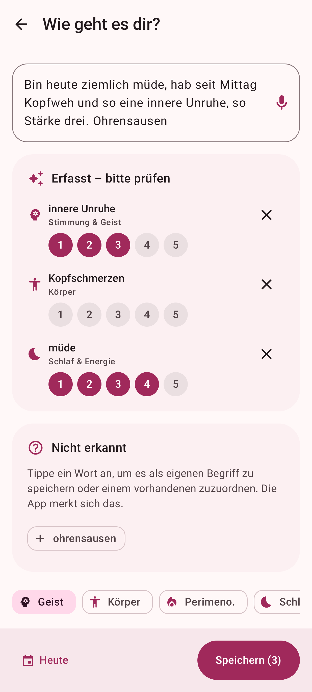
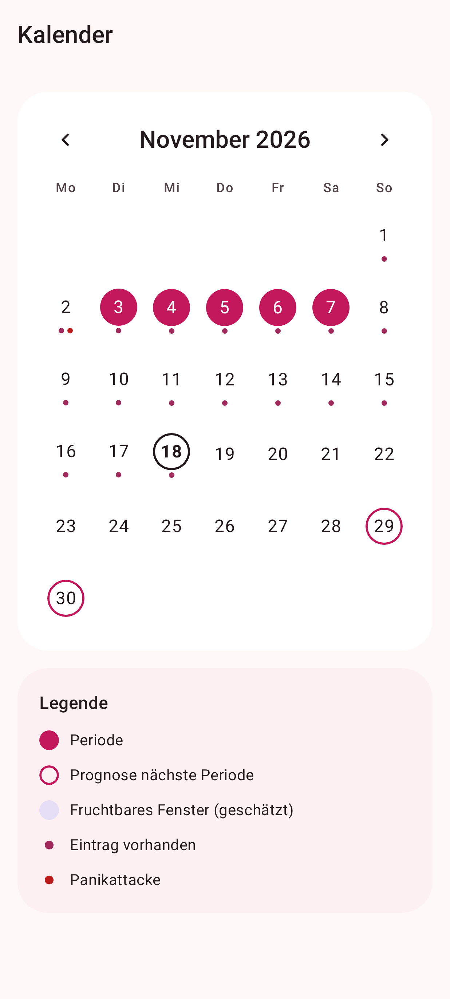

# Fembiond

Android-App zum Tracken von Zyklus, körperlicher und mentaler Verfassung – mit Fokus auf
Perimenopause, innere Unruhe und Panikattacken. Alle Daten bleiben verschlüsselt auf dem Gerät.

Die vollständige Spezifikation steht in [`docs/SPEZIFIKATION.md`](docs/SPEZIFIKATION.md).

| Heute | Eingabe | Kalender | Auswertung |
|---|---|---|---|
|  |  |  |  |

## Funktionen

- **Zyklus:** Zyklusring mit Phase, Zyklustag, Prognose als Spanne, fruchtbares Fenster, Abweichungserkennung,
  Einordnung Perimenopause nach STRAW+10. Die Phase kann auch manuell gesetzt werden (Tipp auf die Phase).
- **Schnelle Eingabe:** Freitext oder Sprache. Begriffe werden automatisch erkannt und kategorisiert, inklusive
  Intensität 1–5, Verneinungen und Tippfehlern. Unbekannte Wörter lassen sich zuordnen, die App lernt mit.
- **Kategorien:** Stimmung & Geist, Körper, Perimenopause, Schlaf & Energie, Blutung, Lebensumstände, Medikation.
- **Panikattacken:** eigener Schnelleintrag mit Stärke, Dauer, Symptomen, Auslösern und dem, was geholfen hat.
- **Notizen:** Freitext wird interpretiert, äußere Umstände landen in „Lebensumstände“ (belastend/neutral/positiv).
- **Medikation:** Behandlungsphasen (z. B. Progesteron oral, Zyklustag 14–25). Die Einnahme lässt sich abhaken,
  die Prognose rechnet mit Abbruchblutung, und es gibt einen Vorher/Nachher-Vergleich.
- **Historie:** Pflegedialog zum Abtippen alter Notizen („03.09.–07.09.“), mit Plausibilitätsprüfung und der Markierung „nachgetragen“.
- **Auswertung:** Zeitraum- und Kategoriefilter, Zykluslängen, Heatmap nach Zyklustag, Vergleich vor/nach der Periode
  (DRSP-Methode), Panik nach Phase, Zusammenhänge, Einfluss von Ereignissen, Verläufe, GAD-7.
- **Export:** Markdown/JSON für KI-Agenten, PDF-Arztbericht, passwortgeschützte Sicherung (AES-256-GCM).
- **Widget** (4×1, skalierbar): Mini-Zyklusring, Phase, Prognose, Einnahme direkt abhaken, Schnelleintrag.
  Bei 4×2 kommen ein Phasenbalken und Schnelltasten dazu. Bei aktivierter App-Sperre zeigt das Widget keine Gesundheitsdaten.
- **Schutz:** SQLCipher-Datenbank mit Schlüssel im Android Keystore, optionale App-Sperre, keine Cloud-Sicherung.

## Installation (Pixel 7)

1. `Fembiond-x.y.z.apk` aufs Handy laden (siehe unten zum Bauen).
2. Öffnen und „Installation aus dieser Quelle zulassen“ bestätigen.
3. Updates mit derselben Signatur (`app/signing/debug.keystore`) installieren sich über die alte Version.
   Die Daten bleiben dabei erhalten.

## Bauen

```bash
./gradlew :app:testDebugUnitTest   # Unit- und Screenshot-Tests (Robolectric)
./gradlew :app:assembleRelease     # APK unter app/build/outputs/apk/release/
```

Voraussetzungen: JDK 21, Android SDK mit Plattform 37.

## Technik

Kotlin, Jetpack Compose (Material 3), Room + SQLCipher, DataStore, WorkManager, Glance.
Die Fachlogik (`domain/`) ist reines Kotlin und durch Unit-Tests abgesichert.

> Die App dokumentiert Muster und stellt keine Diagnosen.
